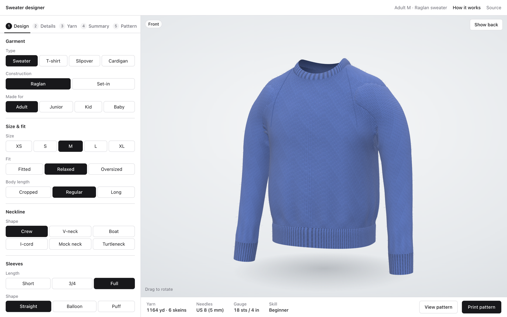

<h1 align="center">knit</h1>

  Design a sweater in 3D. Get the written knitting pattern.

  <a href="https://knit.walkersutton.com"><strong>knit.walkersutton.com</strong></a>
  ·
  <a href="https://knit.walkersutton.com/about">How it works</a>
  ·
  <a href="https://github.com/walkersutton/knit/issues">Tell us what's wrong</a>

  

**knit is a free website for designing a sweater and getting the pattern to knit it.** Choose the shape, size and yarn, watch a 3D sweater change as you decide, and when you're happy, get a written pattern with every stitch count worked out for you. No account, no download, nothing to pay.

**[Start designing →](https://knit.walkersutton.com/design)**

## What you can do

- **See it before you cast on.** Change the neckline, sleeves, colours or fit and a 3D sweater updates right away. Drag it to look from every side.
- **Get a real pattern.** Yarn amounts, needle sizes, the gauge to match, finished measurements in inches and centimetres, and step-by-step instructions with the stitch count after every shaping step.
- **Make it fit you.** Pick a standard size from XS to XL, or type in your own measurements.
- **Use the yarn and needles you have.** Choose fingering, DK, worsted or bulky weight, and tell knit which needles are in your bag. The pattern is rewritten for them and the finished size stays the same.
- **Add colour.** Solid, stripes, Fair Isle, or draw your own colourwork chart square by square.
- **Knit along.** Tick off steps and count rounds as you go. The 3D sweater grows to show how far you've got.
- **New to knitting?** Switch to the Beginner view: every abbreviation is spelled out, tricky steps come with tips, and there are links to free tutorials right where you first need them.
- **Print it or save it as a PDF.**
- **Works offline.** Once it has loaded, you can keep designing and knitting without internet.

### Things you can design

| | |
| --- | --- |
| Garments | Sweater, T-shirt, cardigan, slipover |
| Made for | Adult, junior, kid, baby, in XS to XL, or your own measurements |
| Fit | Fitted, relaxed, oversized; cropped, regular or long |
| Necklines | Crew, V-neck, boat, I-cord, mock neck, turtleneck |
| Sleeves | Short, 3/4 or full; straight, balloon or puff |
| Edges | Ribbing, folded hem, rolled edge, I-cord |
| Colour | Solid, stripes or Fair Isle, in 12 colours |

## Share with other knitters

Signing in is optional and uses your Ravelry account. It lets you:

- **Save your designs and charts** and pick them up on any device.
- **Share patterns and colourwork charts** with everyone. Browse what others have made, put any chart on your own sweater, and open any pattern to adapt it to your yarn and size.
- **Like your favourites**, and have a page of your own that shows what you've shared.

knit only uses Ravelry to find out who you are. It never posts for you and doesn't keep your Ravelry password or access.

## Help us get the patterns right

A pattern that doesn't work on the needles is the worst kind of bug, so corrections from knitters are the most useful thing you can send. If a stitch count or an instruction looks wrong, please [open an issue](https://github.com/walkersutton/knit/issues) and tell us which design you chose. You don't need to know anything about code: just describe what you saw, and a screenshot helps. Ideas and wishes are welcome too.

## For people who build things

knit is open source. If you'd like to run it on your own computer or help with the code, see the [developer guide](docs/DEVELOPING.md).
