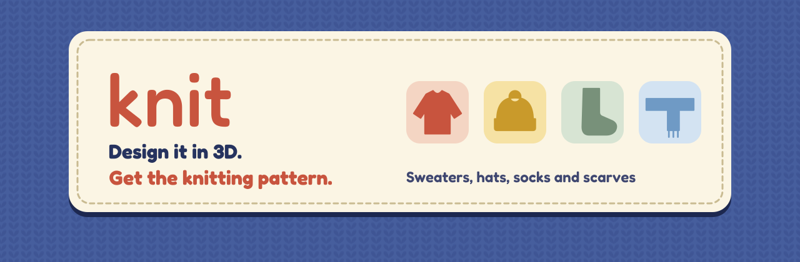

  

  <a href="https://knit.walkersutton.com"><strong>knit.walkersutton.com</strong></a>
  ·
  <a href="https://knit.walkersutton.com/about">How it works</a>
  ·
  <a href="https://github.com/walkersutton/knit/issues">Tell us what's wrong</a>

**knit is a free website for designing something to knit and getting the pattern for it.** Pick a sweater, cardigan, tee, beanie, pair of socks or scarf, choose the shape, size and yarn, and watch a 3D model change as you decide. When you're happy, get a written pattern with every stitch count worked out for you. Draw your own colourwork charts, browse the ones other knitters have shared, and knit along with the model growing as you go. No account, no download, nothing to pay.

**[Start designing →](https://knit.walkersutton.com/design)**

  

## What you can do

- **See it before you cast on.** Change the neckline, sleeves, colours or fit and a 3D model updates right away. Drag it to look from every side.
- **Get a real pattern.** Yarn amounts, needle sizes, the gauge to match, finished measurements in inches and centimetres, and step-by-step instructions with the stitch count after every shaping step.
- **Make it fit you.** Pick a standard size from XS to XL, type in your own measurements, or give a shoe size for socks.
- **Use the yarn and needles you have.** Choose fingering, DK, worsted or bulky weight, and tell knit which needles are in your bag. The pattern is rewritten for them and the finished size stays the same.
- **Add colour.** Solid, stripes, Fair Isle, or a colourwork chart of your own (see below).
- **Feeling lucky?** Roll the dice on the home page for a random design, keep the ones you like and open them in the designer.
- **Knit along.** Tick off steps and count rounds as you go. The 3D model grows to show how far you've got, and there's confetti at the end.
- **New to knitting?** Switch to the Beginner view: every abbreviation is spelled out, tricky steps come with tips, and there are links to free tutorials right where you first need them.
- **Print it or save it as a PDF.**
- **Works offline.** Once it has loaded, you can keep designing and knitting without internet.

### Charts and centerpieces

- **Draw a chart.** Colour in a repeating two-colour pattern square by square. It is worked all over the garment. Prefer a ready-made look? Choose stripes (from pinstripe to bold blocks) or a Fair Isle motif, and pick how big the motif is.
- **Add a centerpiece.** Work one word or picture, such as a name or a heart, once on the front of a sweater, T-shirt or slipover. It can rise up into the yoke.
- **See it on the model.** Charts and centerpieces show up on the 3D model as you draw them, and the pattern includes the chart and the stitch-by-stitch steps to knit it.
- **Keep and share them.** Your charts and centerpieces wait in the designer's side panel to reuse on any design. Sign in to share them with everyone and to put any shared chart on your own garment.

### Things you can design

| | |
| --- | --- |
| Garments | Sweater, T-shirt, cardigan, slipover, button-up vest, beanie, socks, scarf |
| Made for | Adult, junior, kid, baby, in XS to XL, or your own measurements; socks by shoe size |
| Fit | Fitted, relaxed, oversized; cropped, regular or long |
| Necklines | Crew, V-neck, boat, I-cord, mock neck, turtleneck |
| Sleeves | Short, 3/4 or full; straight, balloon or puff; raglan or set-in |
| Beanies | Snug or slouchy, spiral or gathered crown, with or without a pom-pom |
| Socks | Ankle, crew or knee; flap or short-row heel; grafted or round toe |
| Scarves | Narrow, regular or wide; short, regular or long; plain or ribbed ends; fringe |
| Edges | Ribbing, folded hem, rolled edge, I-cord |
| Colour | Solid, stripes or Fair Isle, in 12 colours, plus your own charts and centerpieces |

## Share with other knitters

Signing in is optional and uses your Ravelry account. It lets you:

- **Save your designs, charts and progress** and pick them up on any device.
- **Share patterns, colourwork charts and centerpieces** with everyone. Browse the [pattern](https://knit.walkersutton.com/pattern) and [chart](https://knit.walkersutton.com/chart) catalogues, put any chart on your own garment, and open any pattern to adapt it to your yarn and size.
- **Like your favourites**, and have a page of your own that shows what you've shared.

knit only uses Ravelry to find out who you are. It never posts for you and doesn't keep your Ravelry password or access.

## Help us get the patterns right

A pattern that doesn't work on the needles is the worst kind of bug, so corrections from knitters are the most useful thing you can send. If a stitch count or an instruction looks wrong, please [open an issue](https://github.com/walkersutton/knit/issues) and tell us which design you chose. You don't need to know anything about code: just describe what you saw, and a screenshot helps. Ideas and wishes are welcome too.

## For people who build things

knit is open source. If you'd like to run it on your own computer or help with the code, see the [developer guide](docs/DEVELOPING.md).
